

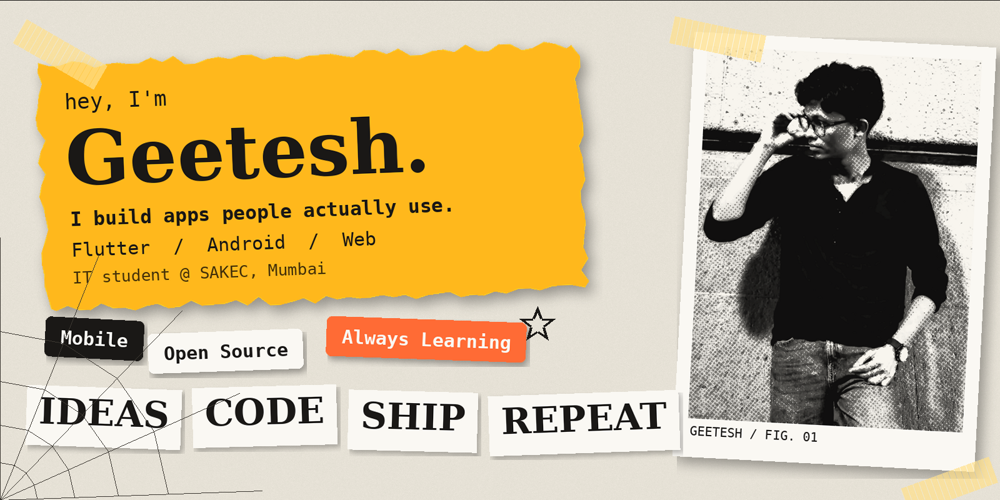

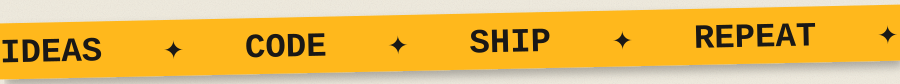

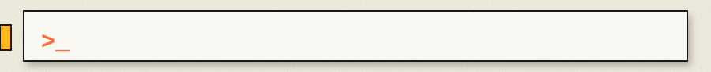

 

 

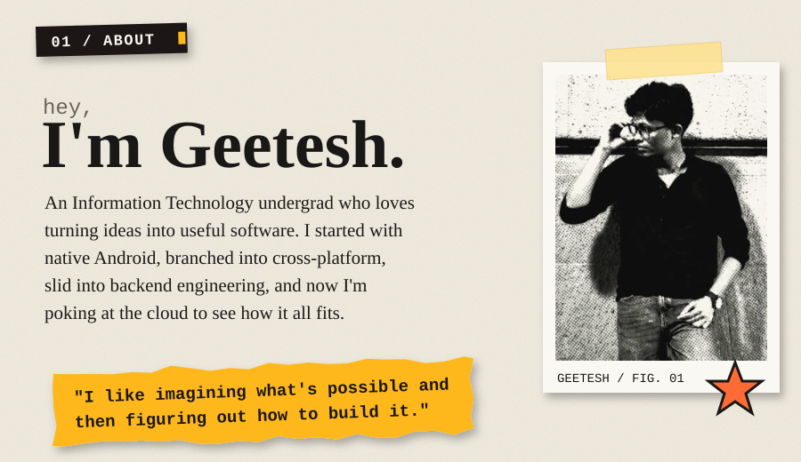

<b>✂️ how I like to build (click to open)</b>

 

I enjoy the whole process, not just one slice of it:

1. **Imagine it.** Start with an idea that feels like it should exist.
2. **Shape it.** Sketch the interface until it feels right in the hand.
3. **Wire it.** Write the logic, connect the data, make it actually work.
4. **Ship it.** Put it in front of real people, then start again.

> Curiosity in mind. Creativity in code.

 


 

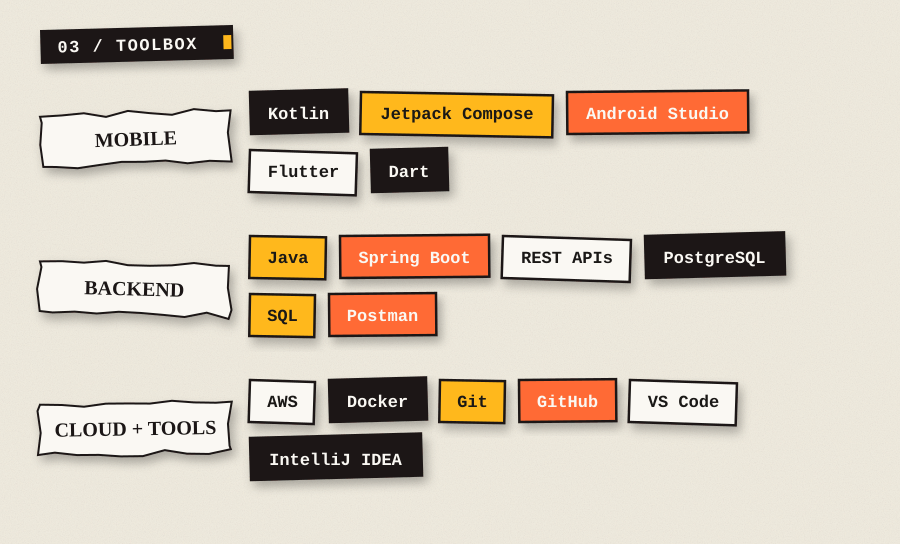

<b>🧰 what each tool is doing for me (click to open)</b>

 

| Stack | What I use it for |
|---|---|
| **Kotlin + Jetpack Compose** | Native Android apps with declarative UI |
| **Flutter + Dart** | One codebase, multiple platforms, plus on-device ML experiments |
| **Java + Spring Boot** | REST APIs and backend logic |
| **PostgreSQL / SQL** | Data modelling and queries |
| **AWS + Docker** | Learning how apps get deployed and scaled |
| **Git + GitHub** | Everything I build lives here |

 


 

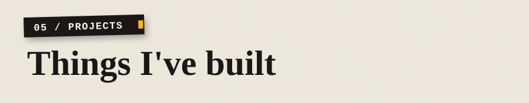

<a href="https://github.com/GeeteshVaity/FloraVision">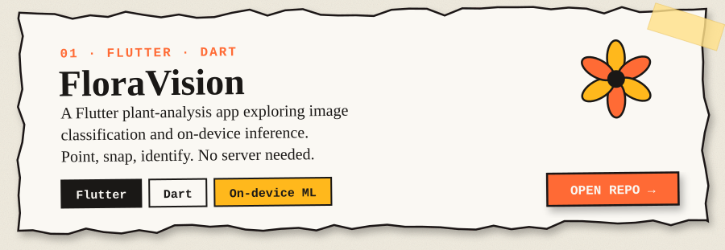</a>

<a href="https://github.com/GeeteshVaity/SettleUp">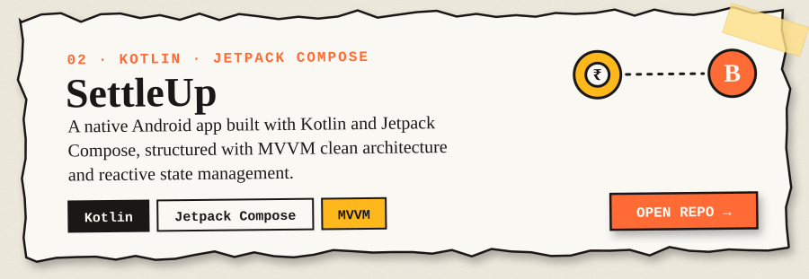</a>

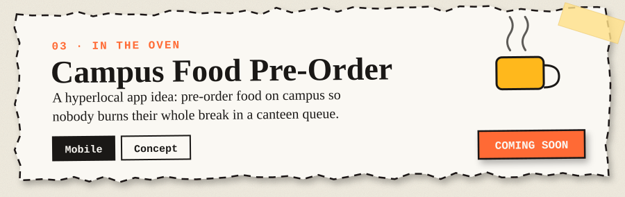

<b>🔍 the short version of each project (click to open)</b>

 

- **FloraVision**: Flutter, Dart. Explores plant image classification and running the model *on the device*, so it works without a server.
- **SettleUp**: Kotlin, Jetpack Compose. A native Android app focused on clean structure: MVVM, reactive state, modern Android practices.
- **Campus Food Pre-Order**: still an idea. Pre-order from campus food counters so a break is spent eating, not queueing.

 

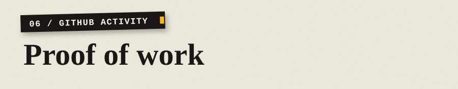

<table>
<tr>
<td width="50%" align="center">

</td>
<td width="50%" align="center">

</td>
</tr>
</table>

 

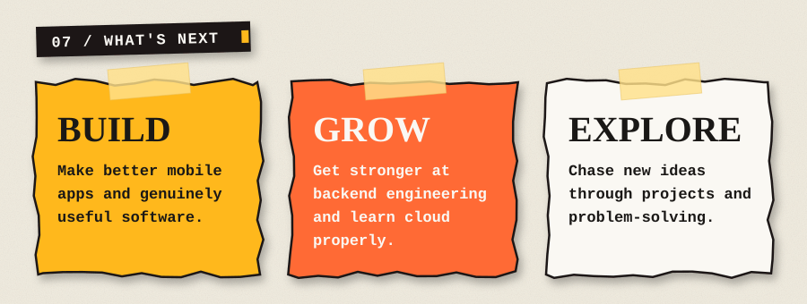

<b>📓 currently leveling up (click to open)</b>

 

- [ ] Flutter state management with Provider, Riverpod and BLoC
- [ ] REST API integration, end to end
- [ ] Backend engineering with Java and Spring Boot
- [ ] Cloud fundamentals on AWS
- [ ] Polishing projects until they're interview-ready

<b>🎯 what I'm looking for (click to open)</b>

 

Internships and entry-level developer roles in **mobile** and **backend**. If you're building something interesting and need someone curious who ships, say hi.

 

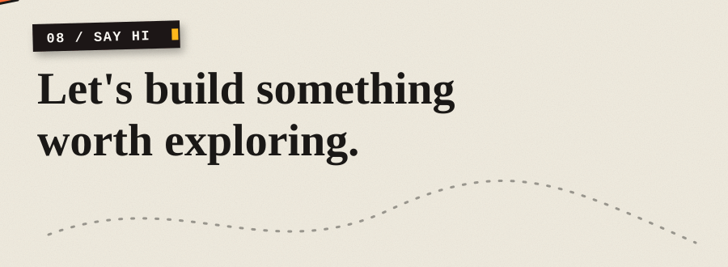

  

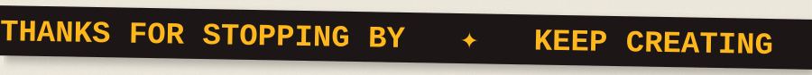

